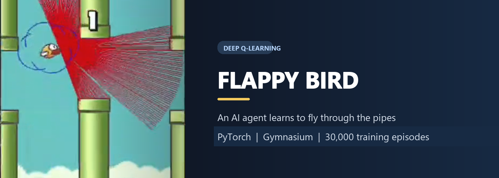

<p align="center">
  
</p>

<h1 align="center">Flappy Bird Reinforcement Learning Agent</h1>

<p align="center">
  A Deep Q-Network (DQN) agent that learns to flap through pipes, avoid collisions, and improve its gameplay from reward-based experience, built with PyTorch and Gymnasium.
</p>

<p align="center">
  
  
  
  
  
</p>

## Overview

This project trains a Flappy Bird agent with **deep reinforcement learning**. At each step, it receives the game state and chooses whether to flap or keep flying. It learns a policy that aims to pass between the pipes by using the rewards from its actions as feedback.

The agent uses a **Deep Q-Network (DQN)** to estimate the value of each action. During training, epsilon-greedy exploration lets it try random actions as well as actions selected by its network. Experience replay reuses sampled past transitions to train the policy, while a separate target network provides steadier learning targets. The best-performing policy is saved as a checkpoint for later evaluation.

The included training screenshot records a run at **30,000 episodes**. The demo video shows the trained agent playing and passing pipes.

## Demo

<p align="center">
  <video src="screenshots/flappy%20trim-%20Trim.mp4" controls width="720">
    Your Markdown viewer does not support embedded video.
  </video>
</p>

If the video does not play in your viewer, [open the MP4 demo](screenshots/flappy%20trim-%20Trim.mp4).

## Training snapshots

<p align="center">
  
</p>

## Features

- Deep Q-Network with a 256-unit hidden layer.
- Epsilon-greedy exploration with configurable decay.
- Experience replay using a bounded replay memory.
- A target network to calculate stable Q-learning targets.
- Saves the best policy checkpoint and training log under `runs/`.
- Automatically selects CUDA, Apple MPS, or CPU when available.
- Includes a separate human-controlled Gymnasium game script.

## Technologies

- **Python** — application and training code
- **PyTorch** — DQN model, optimization, and checkpointing
- **Gymnasium** and **flappy-bird-gymnasium** — game environment
- **NumPy** — random exploration decisions
- **PyYAML** — hyperparameter configuration

## Project structure

```text
.
├── agent.py            # Training and evaluation entry point
├── dqn.py              # Deep Q-Network definition
├── ex_replay.py        # Experience replay memory
├── game_fb.py          # Human-controlled game
├── parameters.yaml     # Environment and training hyperparameters
├── requirements.txt    # Python dependencies
├── screenshots/
│   ├── banner.png
│   ├── 3k ep.png
│   ├── training.png
│   ├── run.png
│   └── flappy trim- Trim.mp4
└── runs/               # Created locally: best model and training log
```

## Getting started

Use Python 3.13 (the version used for this project) and run these commands from the project directory in PowerShell:

```powershell
py -3.13 -m venv venv
.\venv\Scripts\Activate.ps1
python -m pip install --upgrade pip
python -m pip install -r requirements.txt
```

If PowerShell blocks virtual-environment activation, you can skip activation and invoke the environment's Python directly:

```powershell
.\venv\Scripts\python.exe -m pip install -r requirements.txt
```

## Train the agent

```powershell
python .\agent.py flappybirdv0 --train
```

The argument `flappybirdv0` selects the configuration with that key in `parameters.yaml`. Training continues until you stop it with **Ctrl+C**. The script saves the best weights to `runs/flappybirdv0.pt` and records improvements in `runs/flappybirdv0.log`.

To configure training, edit the `flappybirdv0` values in `parameters.yaml`:

| Setting | Purpose |
| --- | --- |
| `env_id` | Gymnasium environment ID |
| `alpha` | Adam optimizer learning rate |
| `gamma` | Future-reward discount factor |
| `epsilon_init` | Initial probability of taking a random action |
| `epsilon_decay` | Per-episode epsilon multiplier |
| `epsilon_min` | Minimum exploration probability |
| `replay_memory_size` | Maximum number of stored transitions |
| `mini_batch_size` | Number of transitions sampled for an update |
| `network_sync_rate` | Number of steps between target-network updates |
| `rewards_threshhold` | Per-episode reward ceiling used by the loop |

## Watch the trained agent

Evaluation loads the checkpoint at `runs/flappybirdv0.pt` and opens the game window:

```powershell
python .\agent.py flappybirdv0
```

Train the model first, or provide a compatible checkpoint at that path. The evaluation mode runs continuously; close the game window to exit.

## License

This project is available under the MIT License. See [LICENSE](LICENSE) for details.

## 👩‍💻 Author

<div align="center">

### Aastha Nayak

Machine Learning · Python · Reinforcement Learning · NLP

💡 Open to collaboration on Machine Learning, Python, and AI projects.

<a href="https://github.com/K-AAS-THA"></a>

<a href="mailto:aasthanayak161@gmail.com"></a>

<a href="https://www.linkedin.com/in/aastha-nayak-76bb7a34b"></a>

⭐ If you found this project helpful, consider giving it a Star!

Made with 💖 using **Python, Reinforcement Learning & PyTorch**

</div>
